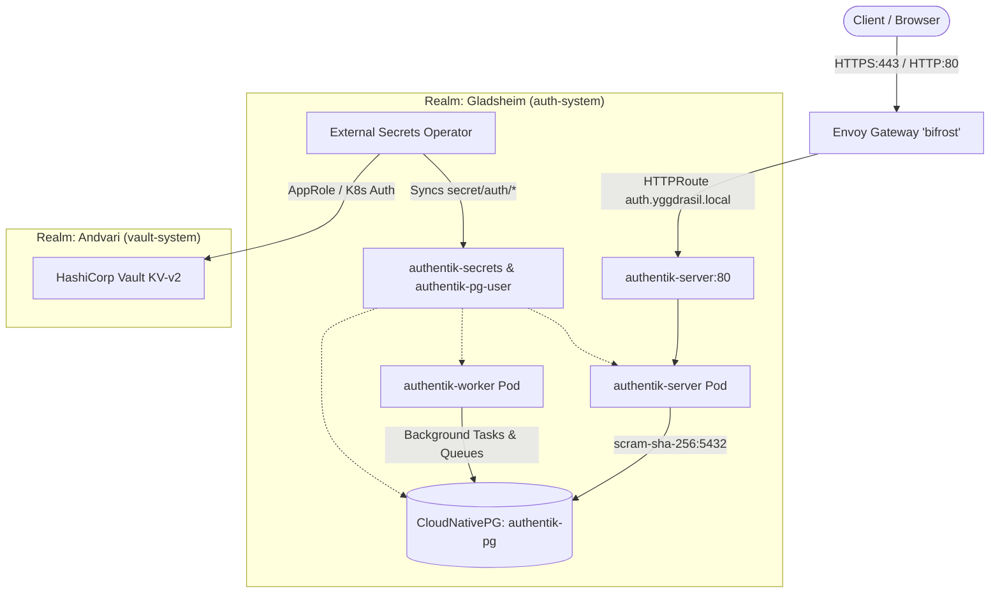

# Authentik Identity Provider (`auth-system`)

This document details the architecture, secret management, sovereign mirroring, and Gateway API routing for the **Authentik** Identity Provider (IdP) deployed in the **Gladsheim** realm of the Yggdrasil cluster.

---

## 1. Architectural Overview & Realm Context

Authentik serves as the unified Single Sign-On (SSO), OpenID Connect (OIDC), OAuth 2.0, SAML 2.0, and LDAP identity provider across the entire Yggdrasil infrastructure.



### Realm & Namespace Specifications
- **Realm:** `gladsheim` (Seat of Odin and the Gods; identity and access control).
- **Namespace:** `auth-system`
- **Pod Security Standards:**
  - `pod-security.kubernetes.io/enforce`: `baseline`
  - `pod-security.kubernetes.io/audit`: `restricted`
  - `pod-security.kubernetes.io/warn`: `restricted`
- **Node-Pool Placement:**
  - `authentik-server` & `authentik-worker`: `yggdrasil.io/node-pool: apps`
  - `authentik-pg` (CloudNativePG): `yggdrasil.io/node-pool: platform`

---

## 2. Authentik 2026.8+ Architecture (Redis-less)

Authentik v2026.8+ eliminates the standalone Redis requirement. Background task scheduling, task worker queues, and session caching run natively against PostgreSQL using optimized transactional queuing:
- **`authentik-server`**: Handles HTTP/S requests, administrative UI, authentication flows, and token issuance. Exposes port `9000` internally, mapped to port `80` by the ClusterIP Service.
- **`authentik-worker`**: Consumes background tasks, flow events, and asynchronous jobs directly from PostgreSQL.
- **Resource Constraints**:
  - Requests: 100m CPU, 256Mi memory.
  - Limits: 1000m CPU, 768Mi memory.

---

## 3. Database Architecture: CloudNativePG (`authentik-pg`)

Authentik utilizes a dedicated, highly reliable CloudNativePG `Cluster` named `authentik-pg`:
- **PostgreSQL Version:** 18.1 (`registry.yggdrasil.local/library/postgresql:18.1`)
- **Authentication:** `scram-sha-256` password encryption.
- **Storage:** 5Gi volume backed by the local-path provisioner.
- **HBA Rules:**
  - `hostssl all all all scram-sha-256`
  - `host all all 10.0.0.0/8 scram-sha-256`
  - `host all all 172.16.0.0/12 scram-sha-256`
- **Bootstrap Secret:** `authentik-pg-user` (contains `username` and `password` sourced from Vault).

---

## 4. Secret Management & Vault Integration

All credentials and sensitive runtime configurations are stored in **HashiCorp Vault** under the KV-v2 secrets engine and synchronized into Kubernetes Secrets via the **External Secrets Operator** (`vault-backend` ClusterSecretStore).

### Vault Paths & Keys
1. **Database Credentials** (`secret/auth/authentik-db`):
   - `username`: `authentik`
   - `password`: Strong generated credential
2. **Application Configuration** (`secret/auth/authentik`):
   - `AUTHENTIK_SECRET_KEY`: High-entropy cryptographic token for signing cookies and tokens.
   - `AUTHENTIK_POSTGRESQL__HOST`: `authentik-pg-rw.auth-system.svc.cluster.local`
   - `AUTHENTIK_POSTGRESQL__NAME`: `authentik`
   - `AUTHENTIK_POSTGRESQL__USER`: `authentik`
   - `AUTHENTIK_POSTGRESQL__PASSWORD`: Matching `secret/auth/authentik-db`
   - `AUTHENTIK_POSTGRESQL__PORT`: `5432`
   - `AUTHENTIK_IN_CLUSTER`: `true`
   - `AUTHENTIK_ERROR_REPORTING__ENABLED`: `false`
   - `AUTHENTIK_EMAIL__HOST`: `docker-mailserver.mail-system.svc.cluster.local`
   - `AUTHENTIK_EMAIL__PORT`: `25`
   - `AUTHENTIK_EMAIL__FROM`: `authentik@yggdrasil.local`

Automated bootstrapping of these secrets is maintained in `scripts/bootstrap-vault-secrets.sh`.

---

## 5. Network, DNS & Gateway API Routing

### Authoritative DNS (`dns-system`)
Authoritative CoreDNS for `yggdrasil.local.` contains an alias pointing to the cluster gateway apex:
```text
auth                IN  CNAME   @
```
DNS queries to `auth.yggdrasil.local` resolve to the Gateway VIP and are signed on-the-fly via DNSSEC.

### Gateway API Route (`HTTPRoute`)
The `authentik-web` HTTPRoute attaches to Gateway `bifrost` in namespace `envoy-gateway-system`:
- **Hostname:** `auth.yggdrasil.local`
- **TLS:** Terminated at `bifrost` using wildcard certificate `bifrost-wildcard-tls` issued by the internal Yggdrasil Root CA.
- **Backend Service:** `authentik-server` on port `80`.
- **Proxy Compatibility:** Requires Envoy proxy `distroless-v1.40.2` matching Envoy Gateway v1.10.

---

## 6. Sovereign Mirroring (Harbor OCI Registry)

In alignment with Yggdrasil's sovereign, air-gapped design principle, all charts and container images are mirrored to the internal Harbor registry (`registry.yggdrasil.local`):

### Helm Charts (`scripts/mirror-charts-to-harbor.sh`)
- `https://charts.goauthentik.io` -> `oci://registry.yggdrasil.local/library/authentik:2026.8.5`

### Container Images (`scripts/mirror-images-to-harbor.sh`)
- `ghcr.io/goauthentik/server:2026.8.5` -> `registry.yggdrasil.local/library/authentik-server:2026.8.5`
- `ghcr.io/goauthentik/ldap:2026.8.5` -> `registry.yggdrasil.local/library/authentik-ldap:2026.8.5`
- `docker.io/envoyproxy/envoy:distroless-v1.40.2` -> `registry.yggdrasil.local/library/envoy:distroless-v1.40.2`

---

## 7. Operational Verification

To verify that the Authentik deployment is operational:
```bash
# Verify pods in auth-system
kubectl get pods -n auth-system

# Verify CloudNativePG cluster health
kubectl get cluster -n auth-system authentik-pg

# Verify ExternalSecrets synchronization
kubectl get externalsecret -n auth-system

# Query DNS resolution
dig @127.0.0.1 -p 5353 auth.yggdrasil.local +short

# Verify HTTP/HTTPS endpoints via Envoy Gateway
curl -kIv --resolve auth.yggdrasil.local:443:127.0.0.1 https://auth.yggdrasil.local/
curl -kfsSL --resolve auth.yggdrasil.local:443:127.0.0.1 https://auth.yggdrasil.local/setup
```

---

## 8. Kubernetes API OIDC Integration & RBAC

Authentik provides sovereign OpenID Connect (OIDC) identity federation for `kubectl` and the Kubernetes API server.

- **Provider**: `kubernetes-k8s-oidc`
- **Application Slug**: `k8s` (`https://auth.yggdrasil.local/application/o/k8s/`)
- **Client ID**: `kubernetes` (Client Type: `public`)
- **Signing Algorithm**: `RS256` (asymmetric signature verifiable via cluster Root CA)
- **Claim Mapping**: User groups in Authentik are mapped into the standard OIDC `groups` claim.
- **Automated Configuration Script**: [`scripts/setup-authentik-k8s.py`](../scripts/setup-authentik-k8s.py)
- **User Onboarding Script**: [`scripts/generate-user-kubeconfig.sh`](../scripts/generate-user-kubeconfig.sh)

For complete RBAC scoping, multi-tenancy quotas, and onboarding runbooks, see [**User Management & Multi-Tenancy (`user-management-and-multi-tenancy.md`)**](user-management-and-multi-tenancy.md).
