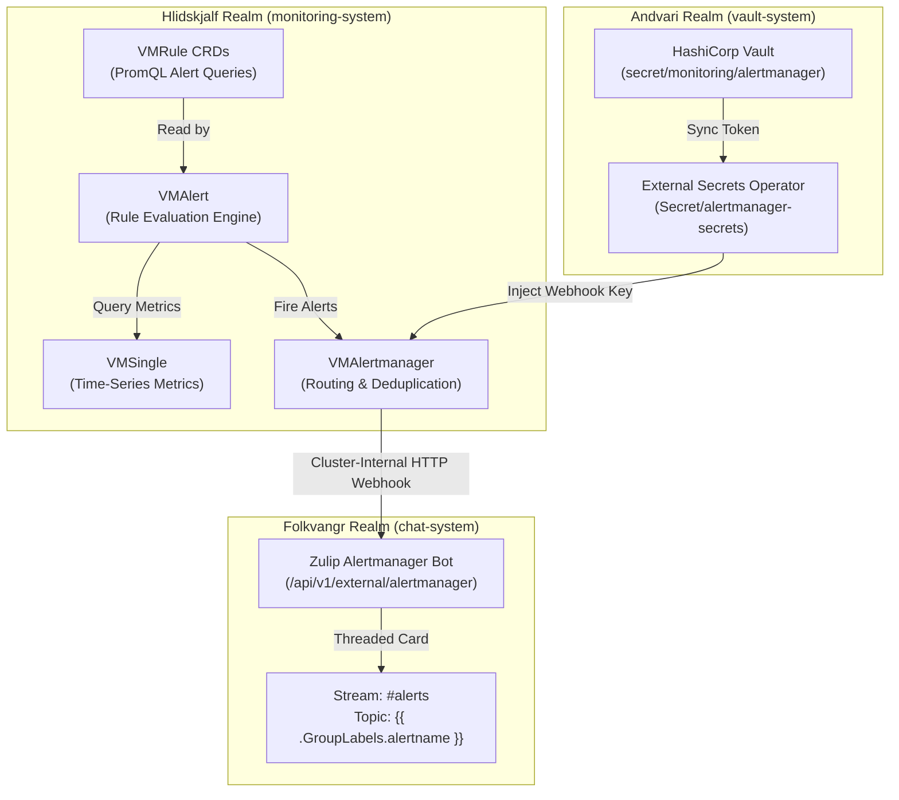

# Alerting Architecture: VMAlert, Alertmanager & Zulip Notifications

## Purpose & Overview

In **Yggdrasil**, monitoring telemetry is aggregated into VictoriaMetrics (*Hlidskjalf* realm, `monitoring-system`). When cluster health degrades or thresholds are breached, proactive alerts should notify cluster administrators.

This guide documents the architecture, configuration, and deployment runbook for:
- **VMAlert (`operator.victoriametrics.com/v1beta1`)**: Evaluates alerting rules (`VMRule`) by executing PromQL / MetricsQL queries against `VMSingle`.
- **VMAlertmanager / Alertmanager (`operator.victoriametrics.com/v1beta1`)**: Receives firing alerts, deduplicates, groups, and routes them to notification receivers.
- **Zulip Notifications (*Folkvangr* realm, `chat-system`)**: Formatted, threaded notification stream `#alerts` inside Zulip using Zulip's native Alertmanager webhook integration.

---

## Architectural Topology & Flow



### Alerting Lifecycle
1. **Scraping & Storage**: `VMAgent` ingests host hardware metrics (`node-exporter`) and cluster state (`kube-state-metrics`) into `VMSingle` at `http://vmsingle-yggdrasil-vmsingle.monitoring-system.svc.cluster.local:8429`.
2. **Evaluation**: `VMAlert` polls `VMSingle` every `30s` executing queries defined in `VMRule` resources.
3. **Dispatch**: When an evaluation matches a rule's `for` duration (e.g. `5m`), `VMAlert` pushes the active alert to `VMAlertmanager`.
4. **Routing & Delivery**: `VMAlertmanager` batches alerts matching the routing tree and issues an HTTP POST to Zulip's Alertmanager integration endpoint:
   `http://zulip.chat-system.svc.cluster.local/api/v1/external/alertmanager?api_key=${ZULIP_BOT_KEY}&stream=alerts`
5. **Threaded Presentation**: Zulip automatically categorizes alerts by topic (using the alert name or group label), threads updates to the same alert, and posts an alert resolution notice once `VMAlert` confirms healthy metric state (`send_resolved: true`).

---

## Step-by-Step Configuration Runbook

### Step 1: Create Incoming Webhook Bot in Zulip

1. Log into Zulip at `https://chat.yggdrasil.local` with administrator credentials (`admin@yggdrasil.local`).
2. Navigate to **Organization settings** (gear icon) -> **Users** -> **Bots** -> **Add a new bot**.
3. Fill in the bot details:
   - **Bot type**: `Incoming webhook`
   - **Bot name**: `Alertmanager`
   - **Bot email**: `alertmanager-bot@yggdrasil.local`
4. Create a dedicated stream named `#alerts` (or `#monitoring`) and subscribe relevant administrators.
5. Copy the generated **API Key** for the Alertmanager bot.

---

### Step 2: Store Webhook Secret in HashiCorp Vault

Store the bot API key in Vault under `secret/monitoring/alertmanager`:

```bash
# Obtain Vault root token from vault-system/secret/vault-init-keys
ROOT_TOKEN=$(kubectl -n vault-system get secret vault-init-keys -o jsonpath='{.data.root-token}' | base64 -d)

# Store the Zulip Alertmanager bot API key in Vault KV-v2
kubectl -n vault-system exec vault-0 -- env VAULT_TOKEN="${ROOT_TOKEN}" vault kv put secret/monitoring/alertmanager \
  zulip-api-key="<ZULIP_BOT_API_KEY>"
```

Define the ExternalSecret in `apps/base/monitoring/alertmanager-secret.yaml`:

```yaml
apiVersion: external-secrets.io/v1
kind: ExternalSecret
metadata:
  name: alertmanager-secrets
  namespace: monitoring-system
  labels:
    yggdrasil.io/realm: hlidskjalf
spec:
  refreshInterval: 1h
  secretStoreRef:
    kind: ClusterSecretStore
    name: vault-backend
  target:
    name: alertmanager-secrets
    creationPolicy: Owner
  dataFrom:
    - extract:
        key: monitoring/alertmanager
```

---

### Step 3: Deploy VMAlertmanager

Create `apps/base/monitoring/vmalertmanager.yaml` configuring the Zulip receiver:

```yaml
apiVersion: operator.victoriametrics.com/v1beta1
kind: VMAlertmanager
metadata:
  name: yggdrasil-alertmanager
  namespace: monitoring-system
  labels:
    yggdrasil.io/realm: hlidskjalf
spec:
  image:
    repository: registry.yggdrasil.local/library/alertmanager
    tag: v0.27.0
  replicaCount: 1
  nodeSelector:
    yggdrasil.io/node-pool: platform
  configSecret: alertmanager-config
---
apiVersion: v1
kind: Secret
metadata:
  name: alertmanager-config
  namespace: monitoring-system
  labels:
    yggdrasil.io/realm: hlidskjalf
stringData:
  alertmanager.yaml: |
    global:
      resolve_timeout: 5m

    route:
      group_by: ['alertname', 'namespace', 'job']
      group_wait: 30s
      group_interval: 5m
      repeat_interval: 4h
      receiver: 'zulip'

    receivers:
      - name: 'zulip'
        webhook_configs:
          - url: 'http://zulip.chat-system.svc.cluster.local/api/v1/external/alertmanager?api_key=<ZULIP_BOT_API_KEY>&stream=alerts'
            send_resolved: true
            http_config:
              follow_redirects: true
```

> [!TIP]
> To route alerts to different topics dynamically, Zulip accepts a `&topic=` query parameter. For example, `&topic={{ .GroupLabels.alertname }}` or `&topic={{ .GroupLabels.namespace }}`.

---

### Step 4: Deploy VMAlert

Create `apps/base/monitoring/vmalert.yaml` to execute queries against `VMSingle`:

```yaml
apiVersion: operator.victoriametrics.com/v1beta1
kind: VMAlert
metadata:
  name: yggdrasil-vmalert
  namespace: monitoring-system
  labels:
    yggdrasil.io/realm: hlidskjalf
spec:
  image:
    repository: registry.yggdrasil.local/library/vmalert
    tag: v1.115.0
  replicaCount: 1
  nodeSelector:
    yggdrasil.io/node-pool: platform
  evaluationInterval: 30s
  datasource:
    url: "http://vmsingle-yggdrasil-vmsingle.monitoring-system.svc.cluster.local:8429"
  notifiers:
    - url: "http://vmalertmanager-yggdrasil-alertmanager.monitoring-system.svc.cluster.local:9093"
  selectAllByDefault: true
```

---

### Step 5: Recommended Cluster Alert Rules (`VMRule`)

Create `apps/base/monitoring/alert-rules.yaml` containing core production alerts for Yggdrasil:

```yaml
apiVersion: operator.victoriametrics.com/v1beta1
kind: VMRule
metadata:
  name: yggdrasil-cluster-rules
  namespace: monitoring-system
  labels:
    yggdrasil.io/realm: hlidskjalf
spec:
  groups:
    - name: nodes
      rules:
        - alert: NodeHighCpuLoad
          expr: 100 - (avg by (instance) (rate(node_cpu_seconds_total{mode="idle"}[5m])) * 100) > 85
          for: 5m
          labels:
            severity: warning
          annotations:
            summary: "High CPU load on {{ $labels.instance }}"
            description: "Node CPU utilization is {{ $value | printf "%.1f" }}% over the last 5 minutes."

        - alert: NodeLowDiskSpace
          expr: (node_filesystem_free_bytes{mountpoint="/"} / node_filesystem_size_bytes{mountpoint="/"}) * 100 < 15
          for: 5m
          labels:
            severity: critical
          annotations:
            summary: "Low root disk space on {{ $labels.instance }}"
            description: "Root filesystem free space is below 15% (current: {{ $value | printf "%.1f" }}%)."

    - name: workloads
      rules:
        - alert: PodCrashLooping
          expr: rate(kube_pod_container_status_restarts_total[5m]) * 60 > 2
          for: 5m
          labels:
            severity: critical
          annotations:
            summary: "Pod {{ $labels.pod }} in namespace {{ $labels.namespace }} is crashlooping"
            description: "Container {{ $labels.container }} restarted more than 2 times in 5 minutes."

        - alert: PVCStorageFillingUp
          expr: (kubelet_volume_stats_available_bytes / kubelet_volume_stats_capacity_bytes) * 100 < 15
          for: 5m
          labels:
            severity: warning
          annotations:
            summary: "PVC {{ $labels.persistentvolumeclaim }} low available space"
            description: "PVC in {{ $labels.namespace }} has less than 15% space remaining."

    - name: core-services
      rules:
        - alert: CoreDNSDown
          expr: absent(up{job="coredns"} == 1)
          for: 2m
          labels:
            severity: critical
          annotations:
            summary: "CoreDNS service is down"
            description: "No healthy CoreDNS instances detected in dns-system."

        - alert: PostgresqlReplicationLag
          expr: cnp_collector_replication_lag > 30
          for: 2m
          labels:
            severity: warning
          annotations:
            summary: "CloudNativePG replica lag high on {{ $labels.pod }}"
            description: "PostgreSQL replica lag exceeded 30 seconds."
```

---

## Testing & Verification

1. **Verify Alertmanager Delivery Pipeline**:
   Send a synthetic test alert directly to VMAlertmanager from within the cluster:
   ```bash
   kubectl -n monitoring-system exec deploy/vmsingle-yggdrasil-vmsingle -- \
     wget -qO- --post-data='[{"labels":{"alertname":"TestClusterAlert","severity":"warning","instance":"test"},"annotations":{"summary":"Synthetic test alert from Yggdrasil CLI","description":"Validating Zulip webhook alert routing"}}]' \
     http://vmalertmanager-yggdrasil-alertmanager.monitoring-system.svc.cluster.local:9093/api/v2/alerts
   ```

2. **Verify Zulip Stream**:
   Open `https://chat.yggdrasil.local/#narrow/stream/alerts/topic/TestClusterAlert` and confirm the formatted notification card appears with alert status `FIRING`.

3. **Verify Resolution**:
   Send the resolved payload with `endsAt`:
   ```bash
   kubectl -n monitoring-system exec deploy/vmsingle-yggdrasil-vmsingle -- \
     wget -qO- --post-data='[{"labels":{"alertname":"TestClusterAlert","severity":"warning","instance":"test"},"endsAt":"2026-11-11T12:00:00Z"}]' \
     http://vmalertmanager-yggdrasil-alertmanager.monitoring-system.svc.cluster.local:9093/api/v2/alerts
   ```
   Confirm the topic in `#alerts` receives the green `RESOLVED` notice.
